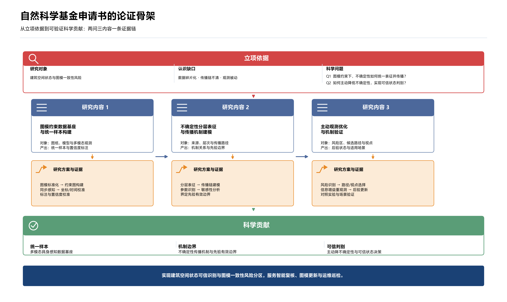
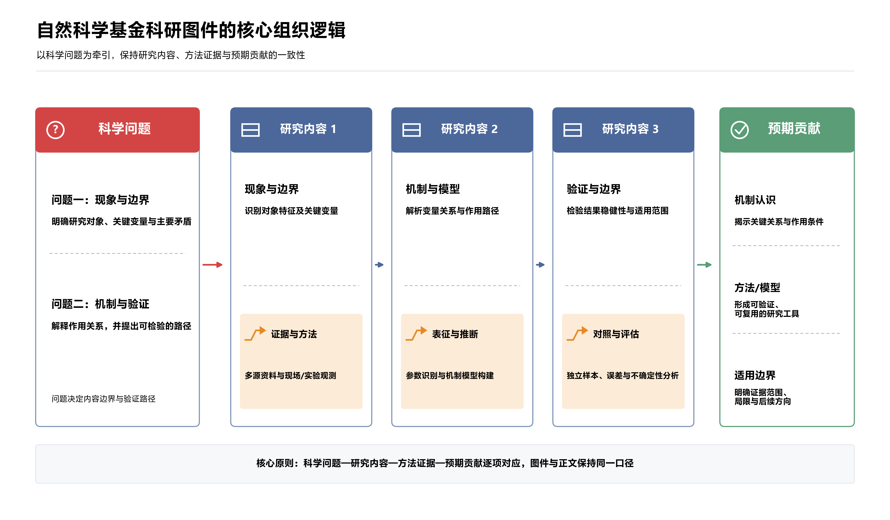
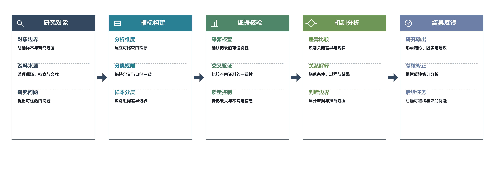
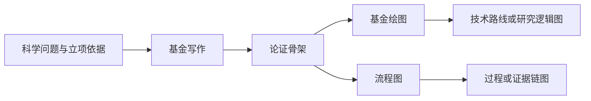

# AILatest Skill

面向科研写作、基金图件和论文级流程图的公开 Skill 合集。每个 Skill 都是独立目录：带工作流、风格规范、可复现脚本，以及一张不含个人材料的合成示意图。

Public Codex skills for research writing, grant figures, and publication-ready flowcharts. Each skill is a standalone directory with a workflow, style notes, a reproducible script, and a synthetic diagram.

[中文说明](#这是什么) · [English](#english)

Skill 没有单独的产品网站。公开入口就是本仓库。[AILatest 工作室](https://ailatest.org/zh/) 上的 Journal、Path、Major 与文献侦探 / RefCheck 是同系列的其他产品，链接见文末。

There is no separate Skill website. This repository is the public entry. Sibling products on the [AILatest studio](https://ailatest.org/en/) are listed at the end.

## 这是什么

把基金正文、技术路线图和过程流程图拆成可单独安装的 Skill，而不是一叠不能复核的提示词。当前三件可以一起用：

1. **写作**先把科学问题、研究内容、方法和证据收成一条论证链。
2. **基金绘图**把这条论证链画成可追溯的科研图件，并核对图文是否一致。
3. **流程图**把任意有序过程画成可导出的论文级流程图，阶段数和方向可以变。

示意图都是为公开仓库重新设计的合成内容，不对应任何个人申请书、论文或真实项目数据。

## 收录的 Skill

| Skill | 中文名 | 做什么 | 主要产出 |
| --- | --- | --- | --- |
| [`write-natural-science-fund-proposals`](skills/write-natural-science-fund-proposals/) | 自然科学基金写作 | 围绕科学问题组织立项依据、研究内容、方法、证据、成果和终稿核查 | 论证骨架、正文修订与 DOCX 核查 |
| [`design-natural-science-fund-figures`](skills/design-natural-science-fund-figures/) | 自然科学基金绘图 | 把研究问题、内容、方法和结果画成技术路线图或研究逻辑图，并做图文同步 | SVG 源文件、PNG 预览、Word 图注核查 |
| [`draw-process-flowchart`](skills/draw-process-flowchart/) | 通用流程图绘制 | 绘制 2–6 个阶段的横向或纵向流程图，统一色块、箭头、分隔和字体 | PNG、SVG、PDF |

## 示意图

下面三张图都在仓库里，可以直接点开大图。它们展示版式和论证结构，不展示某一次真实申请或实验数据。

### 基金写作：论证骨架

立项依据收成两个科学问题，三个研究内容各自对应方法与证据，最后落到科学贡献和应用边界。



说明与生成配置：[`examples/write-natural-science-fund-proposals`](examples/write-natural-science-fund-proposals/)。同图也放在 [`skills/write-natural-science-fund-proposals/assets/`](skills/write-natural-science-fund-proposals/assets/proposal-core-logic.png)。

### 基金绘图：问题、内容与证据

两个科学问题牵引三个研究内容，每个内容块下面是方法与证据，汇入预期贡献。



说明与生成配置：[`examples/design-natural-science-fund-figures`](examples/design-natural-science-fund-figures/)。同图也放在 [`skills/design-natural-science-fund-figures/assets/`](skills/design-natural-science-fund-figures/assets/fund-figure-logic.png)。

### 流程图：五阶段科研证据链

横向五阶段：研究对象、指标构建、证据核验、机制分析、结果反馈。色块标题、线性图标、虚线分隔和实心箭头来自同一套视觉规则。



说明与生成配置：[`examples/draw-process-flowchart`](examples/draw-process-flowchart/)。同图也放在 [`skills/draw-process-flowchart/assets/`](skills/draw-process-flowchart/assets/research-evidence-flow.png)。SVG 与 PDF 和 PNG 放在同一 `assets/` 目录。

## 三件如何接在一起



写作 Skill 负责正文里的问题和证据是否对得上。绘图 Skill 负责这些句子进图之后仍然对得上。流程图 Skill 不绑定基金栏目，任何有序过程都可以画。

## 快速使用

克隆本仓库：

```bash
git clone https://github.com/stonecanon/ailatest-skill.git
```

在 Codex 中，把需要的 Skill 目录复制到本地 Skill 目录。一次复制一个：

```bash
cp -R skills/write-natural-science-fund-proposals "$HOME/.codex/skills/write-natural-science-fund-proposals"
cp -R skills/design-natural-science-fund-figures "$HOME/.codex/skills/design-natural-science-fund-figures"
cp -R skills/draw-process-flowchart "$HOME/.codex/skills/draw-process-flowchart"
```

然后按名称调用，例如：

```text
$write-natural-science-fund-proposals
$design-natural-science-fund-figures
$draw-process-flowchart
```

流程图的本地模板可以直接跑。默认读取本机的 Microsoft YaHei；字体路径不同时，用命令行参数传入：

```bash
python3 skills/draw-process-flowchart/scripts/draw_flowchart_template.py \
  --orientation horizontal \
  --output-dir ./output \
  --stem process_flowchart \
  --bottom-labels 输入 分析 执行 反馈
```

每个 Skill 的调用示例、校验脚本和风格说明写在各自的 `README.md` 与 `SKILL.md` 里。

## 仓库结构

```text
skills/     可单独安装的 Skill：SKILL.md、references/、scripts/、agents/、assets/
examples/   与技能配套的合成示意图、配置和渲染脚本
LICENSE     MIT License
```

## 公开边界

- 不提交 API key、访问 token、密码、私钥、Cookie 或个人配置。
- 不提交本机绝对路径、个人邮箱、临时目录和带身份信息的日志。
- 示例图使用重新设计的合成内容，不上传个人论文截图或原始申请书。
- 上传前检查文本、脚本、SVG、PDF 元数据和 Git 历史里的隐私信息。
- 文献、分区、影响因子、设备参数和成果表述以可核验的来源为准。Skill 不发明引用或指标。

新增 Skill 时，在 `skills/<skill-name>/` 建立独立目录，并补一个不含个人信息的说明或示例。提交前运行该 Skill 自带的校验脚本。

## 同系列产品

这些链接来自 [AILatest 公开产品索引](https://ailatest.org/llms.txt)。Skill 本身没有单独站点。

| 产品 | 做什么 | 入口 |
| --- | --- | --- |
| Skill | 本仓库：科研写作与绘图 Skill | [stonecanon/ailatest-skill](https://github.com/stonecanon/ailatest-skill) |
| Journal · 知刊 | 期刊检索、分区、影响因子与预警 | [journal.ailatest.org](https://journal.ailatest.org/) |
| Path | 美国院校费用、认证与结果对照 | [path.ailatest.org](https://path.ailatest.org/) |
| Major · 知途 | 专业与志愿顺序 | [major.ailatest.org](https://major.ailatest.org/) |
| RefCheck · 文献侦探 | 逐条核验参考文献，并提示撤稿 | [refcheck.ailatest.org](https://refcheck.ailatest.org/) |

工作室首页：[中文](https://ailatest.org/zh/) · [English](https://ailatest.org/en/)。公开问题与建议请开 [Issues](https://github.com/stonecanon/ailatest-skill/issues)。

## English

AILatest Skill is the public showcase for research-writing and figure skills in the AILatest family. It is a GitHub collection, not a hosted app. `skill.ailatest.org` does not exist; use this repository.

### What you can install

| Skill | Use it to | Output |
| --- | --- | --- |
| [`write-natural-science-fund-proposals`](skills/write-natural-science-fund-proposals/) | Organize a natural-science fund proposal around scientific questions, evidence, and a final consistency check | Argument skeleton, prose revisions, DOCX audit |
| [`design-natural-science-fund-figures`](skills/design-natural-science-fund-figures/) | Turn those questions, contents, and methods into traceable proposal figures | SVG master, PNG preview, Word caption checks |
| [`draw-process-flowchart`](skills/draw-process-flowchart/) | Draw a 2–6 stage paper figure, horizontal or vertical, with one visual system | PNG, SVG, PDF |

### Diagrams in this repo

The images above are synthetic demos checked into the repository. They show structure and layout only.

- [Proposal argument skeleton](examples/write-natural-science-fund-proposals/assets/proposal-core-logic.png): basis, two scientific questions, three research blocks, evidence, contribution, and application boundary.
- [Fund-figure logic](examples/design-natural-science-fund-figures/assets/fund-figure-logic.png): two questions driving three content blocks, each with a method and evidence layer, closing on an expected contribution.
- [Research evidence flow](examples/draw-process-flowchart/assets/research-evidence-flow.png): five horizontal stages from research object to feedback, with colored headers, line icons, dashed separators, and filled arrows.

Writing keeps the prose consistent. Fund figures keep the drawing consistent with that prose. The flowchart skill is not tied to a grant template; any ordered process can use it.

### Install

```bash
git clone https://github.com/stonecanon/ailatest-skill.git
cp -R skills/draw-process-flowchart "$HOME/.codex/skills/draw-process-flowchart"
```

Invoke with `$draw-process-flowchart`, `$design-natural-science-fund-figures`, or `$write-natural-science-fund-proposals`. Copy only the skill directories you need. Per-skill prompts and check scripts live in each `README.md` and `SKILL.md`.

### Family

| Product | Entry |
| --- | --- |
| Studio | [ailatest.org/en](https://ailatest.org/en/) |
| Journal | [journal.ailatest.org](https://journal.ailatest.org/) |
| Path | [path.ailatest.org](https://path.ailatest.org/) |
| Major | [major.ailatest.org](https://major.ailatest.org/) |
| RefCheck | [refcheck.ailatest.org](https://refcheck.ailatest.org/) |

Examples are synthetic. Do not commit keys, local paths, personal manuscripts, or logs. License: [MIT](LICENSE). Questions and suggestions: [Issues](https://github.com/stonecanon/ailatest-skill/issues).
